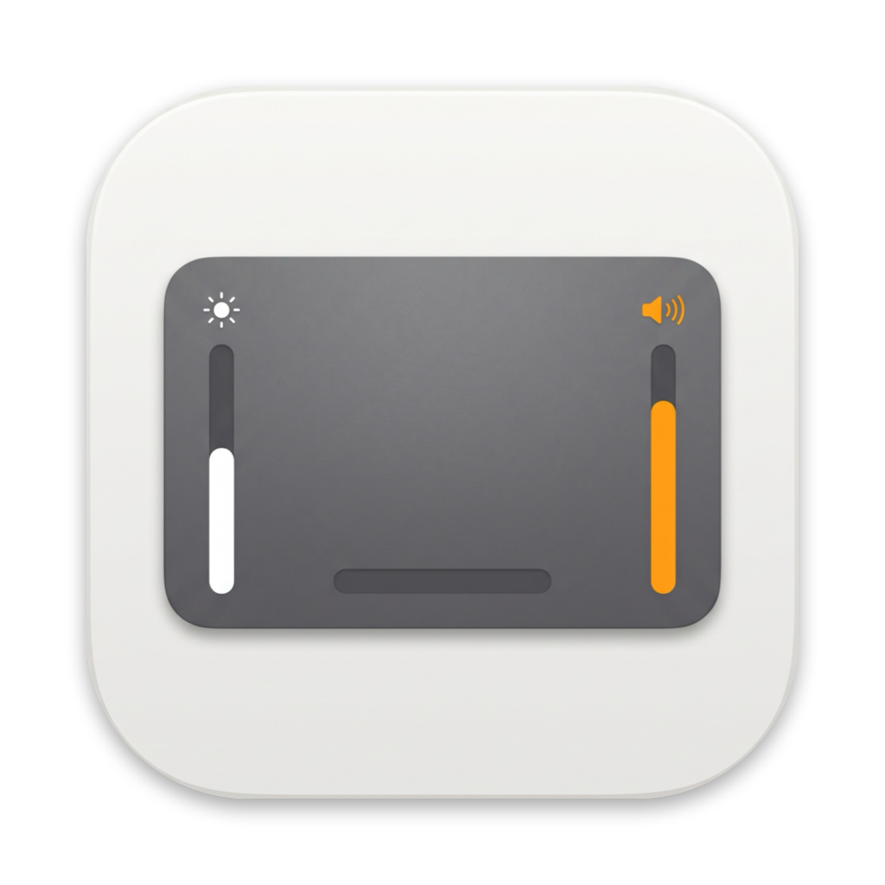
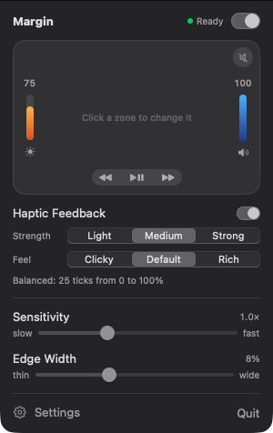
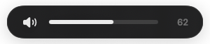
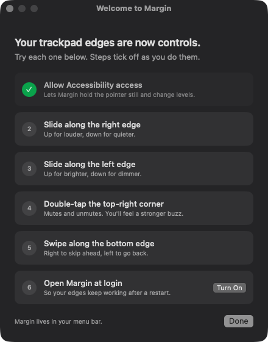
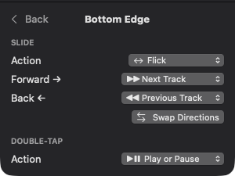
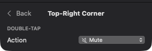
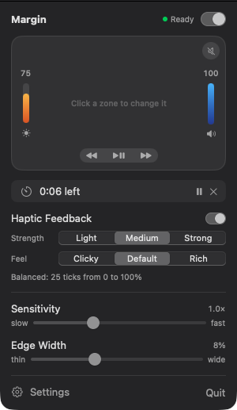
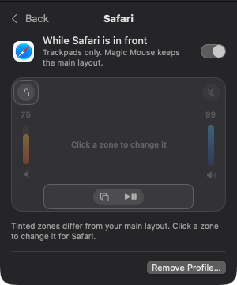
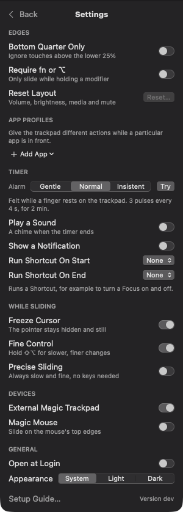

<p align="center">
  
</p>

<h1 align="center">Margin</h1>

<p align="center">
  <b>Turn the edges of your Mac's trackpad into controls.</b><br>
  Slide the side for volume or brightness, double-tap a corner to mute or lock the screen, flick the bottom to skip a track.
</p>

<p align="center">
  <a href="https://github.com/abdullahabwisk/margin-mac-app/releases/latest"></a>
  <a href="https://github.com/abdullahabwisk/margin-mac-app/actions/workflows/ci.yml"></a>
  
  <a href="LICENSE"></a>
</p>

<p align="center">
  
  &nbsp;&nbsp;
  
</p>

Margin lives in your menu bar and listens to the outer few millimetres of your trackpad. The middle of the trackpad
works exactly as before. **Hold fn or ⌥ (Option)** while you touch an edge or corner to use it, so an ordinary
touch near the edge never changes anything by accident. Out of the box:

| Where | Gesture | What happens |
|---|---|---|
| Right edge | slide up / down | Volume |
| Left edge | slide up / down | Brightness |
| Bottom edge | flick right / left | Next / previous track |
| Bottom edge | double-tap | Play or pause |
| Top-right corner | double-tap | Mute |

Every edge and corner can be changed to something else, and each app can have its own layout. If you'd rather not hold
a key, turn on **Settings → Use without Fn or Option key**.

## Contents

- [Features](#features)
- [Install](#install)
- [First launch](#first-launch)
- [Using Margin](#using-margin)
- [Settings](#settings)
- [Troubleshooting](#troubleshooting)
- [Update or uninstall](#update-or-uninstall)
- [Build from source](#build-from-source)
- [How it works](#how-it-works)
- [License](#license)

## Features

- **Smooth level sliders.** Volume, brightness and microphone level follow your finger continuously, with no 1/16 steps
  and no system HUD. A small overlay in the middle of the screen shows the level.
- **Eight zones you can rebind.** Four edges (left, right, top, bottom) and four corners. Click a zone in the menu's
  trackpad diagram and pick what it does.
- **Lots of actions.**
  - *Slide:* volume, microphone, brightness, undo / redo, switch tabs, switch Spaces, arrow keys, or a *flick* that
    runs one command each way (next / previous track by default), or the timer dial.
  - *Double-tap:* play / pause, next / previous track, mute, mute microphone, lock screen, screenshot, Mission Control,
    App Windows, Show Desktop, screen saver, sleep display, start / pause / cancel a timer, launch any app, or any
    keyboard shortcut you record.
- **Timer dial.** Turn any edge into a dial: slide to set 1 to 90 minutes, lift to start. The time left shows in the
  menu bar, and when it ends the trackpad buzzes as a silent alarm. It can also play a chime, show a notification and
  run a Shortcut on start and end (to turn a Focus on and off, say).
- **Hot corners on the trackpad.** Double-tap a corner. Taps are told apart from real clicks, including a right-click
  corner if you use one.
- **App profiles.** Give the trackpad different actions while a particular app is in front, such as tab switching on
  the bottom edge in Safari. A line in the menu shows which profile is active.
- **No accidental triggers.** Gestures only work while you hold fn or ⌥, unless you turn on **Use without Fn or
  Option key**.
- **Haptic notches** as you slide, with adjustable strength and feel.
- **The pointer stays put** while you slide, and taps on an edge don't turn into clicks.
- **Fine control.** Hold ⇧⌥ for slower, more precise changes, or turn on Precise Sliding to always slide that way.
- **Magic Mouse** (optional): slide along the mouse's top edges for the same level controls.
- **A setup guide** that ticks off each gesture as you try it.

## Install

**Requirements:** macOS 14 (Sonoma) or later, and a built-in trackpad or Magic Trackpad.

### Option A: one-line install (recommended)

Open **Terminal** (press ⌘Space, type *Terminal*, press Return) and paste:

```bash
curl -fsSL https://raw.githubusercontent.com/abdullahabwisk/margin-mac-app/main/install.sh | bash
```

The script downloads the newest release, puts Margin in `/Applications` (or `~/Applications` if you aren't an admin)
and opens it. You can [read the script](install.sh) before running it.

To install a particular version:

```bash
curl -fsSL https://raw.githubusercontent.com/abdullahabwisk/margin-mac-app/main/install.sh | bash -s -- --version v2.0.0
```

### Option B: download the app

1. Download **Margin-v….zip** from the [latest release](https://github.com/abdullahabwisk/margin-mac-app/releases/latest)
   and double-click it to unzip.
2. Open **Margin.app**. If macOS says it can't check the app for malicious software, click **Done** (not Move to
   Trash), then:
   - **macOS 15 (Sequoia) or later:** open **System Settings → Privacy & Security**, scroll down to
     *"Margin" was blocked* and click **Open Anyway**, then confirm.
   - **macOS 14 (Sonoma):** right-click **Margin.app**, choose **Open**, then click **Open** again.
3. If Margin isn't in your Applications folder yet, it offers to move itself there. Click **Move to Applications**.

> [!TIP]
> If you're comfortable in Terminal, `xattr -dr com.apple.quarantine ~/Downloads/Margin.app` skips step 2.

## First launch

Margin needs **Accessibility** access to change volume and brightness, hold the pointer still while you slide, and
keep edge taps from turning into clicks. It only watches pointer and click events, never the keyboard, and it makes no
network connections.

The setup guide opens the first time you run Margin:

<p align="center">
  
</p>

1. **Allow Accessibility access.** Click **Open Settings** and turn on **Margin** in
   **System Settings → Privacy & Security → Accessibility**. The step ticks itself off once access comes through.
2. **Try each gesture.** Hold fn or ⌥ (Option), then slide the right and left edges, double-tap the top-right corner, and swipe along the bottom
   edge. Each step ticks off as Margin recognises it, and you'll feel a buzz.
3. **Open at login.** Click **Turn On** so Margin starts with your Mac.

You can reopen the guide any time from **Settings → Setup Guide…**.

## Using Margin

Click the Margin icon in the menu bar to open its panel.

### The menu


- **The switch** at the top turns Margin on or off. The dot next to it is green when everything's working.
- **The trackpad diagram** shows what each zone does, with the current volume and brightness. **Click any zone** to
  change it.
- **Haptic Feedback** sets how strong the notches feel (Light, Medium, Strong) and their character (Clicky, Default,
  Rich).
- **Sensitivity** sets how far you slide for a full 0 to 100% sweep.
- **Edge Width** sets how wide the edge zones are. Wider is easier to hit, narrower leaves more of the trackpad for the
  pointer.

<br clear="right">

### Gestures

By default, **hold fn or ⌥ (Option)** as your finger touches the edge or corner; you can let go once a slide has
started. To use gestures without a key, turn on **Settings → Use without Fn or Option key**.

- **Slide:** put one finger down on an edge and slide along it. A slide that starts in the middle of the trackpad is an
  ordinary pointer movement.
- **Flick:** on an edge bound to Flick, slide quickly one way or the other. It fires once per touch.
- **Double-tap:** tap twice quickly on an edge or corner. Physical clicks don't count, so clicking in a corner still
  clicks.
- **Corners:** a touch that starts in a corner and slides goes to the edge it slides along. A double-tap goes to the
  corner.

Hold **⇧⌥** while sliding for finer control.

### Changing what a zone does

Click a zone in the diagram to open its editor.

<p align="center">
  
  &nbsp;&nbsp;
  
</p>

- **Edges** have a **Slide** action and a **Double-tap** action.
- **Corners** have a **Double-tap** action only.
- For a **Flick**, choose the Forward and Back commands. **Swap Directions** reverses them.
- **Launch App…** asks you to pick an app. **Keystroke…** records any shortcut, such as ⌘W.

Double-taps on the left and right edges are allowed, but they can catch taps you meant as clicks near the sides.

To go back to the original layout, use **Settings → Reset Layout**.

### Timer



1. Click an edge in the diagram (the top edge is free by default) and set its **Slide** action to **Timer**.
2. Slide along that edge to set the time: 1-minute steps up to 10 minutes, then 5-minute steps up to 90. The overlay
   shows the time. **Lift your finger to start.**
3. The time left appears next to the menu bar icon, and in the menu with **Pause** and **Cancel** buttons. Slide the
   edge again to change a running timer, or slide it to zero to cancel.
4. When time's up, the overlay says so and the trackpad buzzes whenever a finger rests on it. **Tap anywhere on the
   trackpad** to dismiss it.

For a fixed timer, set a corner's double-tap to **Start Timer…** and choose a length, such as a 25-minute focus block.
Timers keep running through sleep and restarts.

In **Settings → Timer** you can pick how insistent the alarm is (Gentle, Normal, Insistent, with a **Try** button), add
a chime or a notification, and run a Shortcut when the timer starts and ends.

<br clear="right">

### App profiles

A profile changes some zones while a chosen app is in front. Everything else follows your main layout.



1. Open **Settings**, then click **Add App** under *App Profiles*. Pick a running app, or choose one from disk.
2. Click a zone in the profile's diagram and change it. Zones that differ from your main layout are tinted.
3. Pick **Use Global** to put a zone back to the main layout.

While a profile is in charge, the menu says *Using Safari profile* (or whichever app). Turn the profile's switch off to
pause it, or click **Remove Profile…** to delete it.

Profiles apply to trackpads only. A Magic Mouse keeps the main layout.

<br clear="right">

## Settings

Open the menu and click **Settings**.



**Edges**
- **Bottom Quarter Only:** ignore edge touches above the lower quarter of the trackpad.
- **Use without Fn or Option key:** off by default, so edges and corners only respond while you hold fn or ⌥. Turn it
  on to use them with no key held.
- **Reset Layout:** put every zone back to the default.

**App Profiles:** see [App profiles](#app-profiles).

**Timer:** alarm strength, sound, notification and Shortcuts. See [Timer](#timer).

**While Sliding**
- **Freeze Cursor:** hide the pointer and keep it still during a slide.
- **Fine Control:** hold ⇧⌥ for slower, finer changes.
- **Precise Sliding:** always slide slowly and finely, no keys needed.

**Devices**
- **External Magic Trackpad:** listen to a Magic Trackpad as well as the built-in one.
- **Magic Mouse:** slide along the mouse's top edges. Scrolling is held off while you do.

**General**
- **Open at Login**
- **Appearance:** System, Light or Dark.
- **Setup Guide…** reopens the guide.

<br clear="right">

## Troubleshooting

**Margin is turned on in Accessibility, but nothing happens.**
That's an old Accessibility entry left by a previous copy of Margin. Margin notices this and shows a **Reset** button
in the menu and the setup guide. Click it, then switch Margin on again when macOS asks. The install script does this
for you when it updates Margin. To do it by hand:

```bash
tccutil reset Accessibility com.abdullahkhan.Margin
```

**Edge taps click things, or edges trigger when I don't mean them to.**
Turn off **Use without Fn or Option key** (it's off by default), so gestures need fn or ⌥ held. You can also lower
**Edge Width** in the menu or turn on **Bottom Quarter Only**.

**Nothing happens when I slide an edge.**
Hold fn or ⌥ as you touch the edge, or turn on **Settings → Use without Fn or Option key**.

**Slides feel too fast or too slow.**
Change **Sensitivity**, hold ⇧⌥ while sliding, or turn on **Precise Sliding**.

**Brightness doesn't change on an external display.**
Margin sets brightness through macOS, which works for the built-in display and Apple displays. Most other external
monitors don't support it.

**My Magic Trackpad isn't picked up.**
Make sure **Settings → External Magic Trackpad** is on. Margin notices trackpads that connect or disconnect within a few
seconds, and after the Mac wakes.

Something else? Please [open an issue](https://github.com/abdullahabwisk/margin-mac-app/issues).

## Update or uninstall

**Update:** run the [one-line install](#option-a-one-line-install-recommended) again, or download the newest zip.

**Uninstall:**

```bash
curl -fsSL https://raw.githubusercontent.com/abdullahabwisk/margin-mac-app/main/install.sh | bash -s -- --uninstall
```

This quits Margin, deletes the app, and removes its Accessibility entry and settings. To do it by hand: quit Margin,
delete `Margin.app`, remove it from **System Settings → Privacy & Security → Accessibility**, and run
`defaults delete com.abdullahkhan.Margin`.

## Build from source

You need Xcode 15.3 or later, or the Xcode Command Line Tools (Swift 5.10+).

```bash
git clone https://github.com/abdullahabwisk/margin-mac-app.git
cd margin-mac-app
./build.sh install    # build, sign, copy to /Applications and open
```

| Command | What it does |
|---|---|
| `swift build` | Quick debug build |
| `swift test` | Run the `MarginCore` unit tests |
| `./build.sh` | Release build, signed, at `build/Margin.app` |
| `./build.sh install` | Also quit the running copy, install to `/Applications` and open it |
| `./build.sh release` | Also zip it as `build/Margin-v<version>.zip` |

Signing uses `$MARGIN_SIGN_IDENTITY` if it's set, otherwise your first *Apple Development* certificate, otherwise an
ad-hoc signature. macOS ties the Accessibility permission to the signature, so ad-hoc builds have to be approved again
after every rebuild.

```bash
MARGIN_SIGN_IDENTITY="Apple Development: Your Name (TEAMID)" ./build.sh install
```

Handy launch flags for UI work (pass them to the `Margin` binary):

| Flag | What it does |
|---|---|
| `--preview-menu` | Show the menu in an ordinary window. Add `--settings`, `--zone bottomEdge` or `--profile <bundle ID>` to open a page. |
| `--preview-overlay` | Sweep the level overlay without changing the real volume or brightness |
| `--open-panel` | Open the menu bar panel on launch (add `--settings` for Settings) |
| `--preview-timer` | Start a 10-second timer, to try the alarm |
| `--setup-guide` | Show the setup guide |
| `--no-move` | Don't offer to move the app to /Applications |

The app icon artwork is `Resources/AppIcon-source.png`: a rounded-square tile on a solid black background, at least
1024 px square. Run `swift Scripts/make-icon.swift` after changing it. The script cuts the tile out, places it on
Apple's icon grid with a drop shadow, and regenerates `Resources/AppIcon.icns` (16 to 1024 px) and
`Resources/AppIcon-1024.png` (used at the top of this README).

Releases are built by GitHub Actions. See [docs/RELEASING.md](docs/RELEASING.md).

## How it works

| Piece | File |
|---|---|
| Raw finger positions from `MultitouchSupport.framework` (private, loaded with `dlopen`) | `Sources/CMultitouch/CMultitouch.c` |
| Zones, actions, layouts, profiles and migration from older settings, as plain testable Swift | `Sources/MarginCore/` |
| Gesture recognition: edge zones, slides, flicks, double-taps, dropout recovery | `Sources/Margin/TouchEngine.swift` |
| Running commands: media keys, system commands, shortcuts, launching apps | `Sources/Margin/Actions.swift` |
| Volume (CoreAudio) and brightness (DisplayServices), set directly; haptics | `Sources/Margin/SystemControls.swift` |
| Level overlay | `Sources/Margin/LevelOverlay.swift` |
| Event tap that pins the pointer during a slide and swallows clicks from edge taps | `Sources/Margin/InputGate.swift` |
| Settings model | `Sources/Margin/Preferences.swift` |
| Menu panel, trackpad diagram, zone editor and app profiles UI | `Sources/Margin/MenuView.swift`, `TrackpadDiagram.swift`, `ZoneEditor.swift`, `AppProfiles.swift` |
| App lifecycle: devices, wake and reconnect, permission checks | `Sources/Margin/MarginApp.swift` |

Margin uses private APIs and needs Accessibility access, so it can't be sandboxed or sold on the Mac App Store. It's
distributed directly instead.

Work in progress is described in [docs/specs/configurable-edges.md](docs/specs/configurable-edges.md): window snapping
is next.

## License

Copyright (C) 2026 Abdullah Khan

Margin is free software: you can redistribute it and/or modify it under the terms of the GNU General Public License as
published by the Free Software Foundation, either version 3 of the License, or (at your option) any later version. See
[LICENSE](LICENSE) for the full text.
